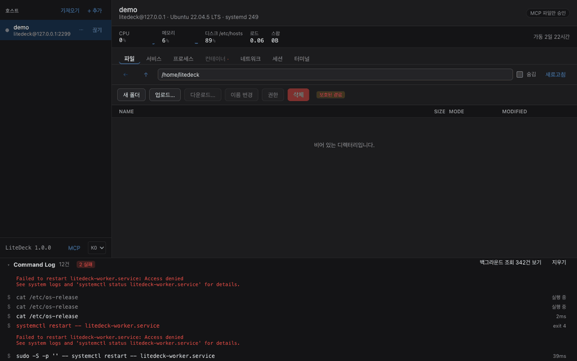

# MCP integration

[← README](../README.md)

<p align="center">
  
</p>

<p align="center"><sub>An MCP client tries to change a file and the <b>diff against what is on the server</b> comes up. Anything approved can be undone.</sub></p>


An MCP client (Claude Code, Claude Desktop) can **read and change** your servers through this
app. Turn it on with the **MCP** button at the bottom of the sidebar.

> [!IMPORTANT]
> **File changes are confirmed by default**, and the dialog shows the literal
> command or file diff. That policy is **owned by the app; the AI cannot turn it off.**

```
Claude Code  ──MCP (local HTTP)──▶  LiteDeck  ──existing SSH──▶  server
```

The client **sits where the GUI sat**: same adapters, same already-authenticated SSH connection,
same Command Log. What it asks for scrolls past tagged `MCP`. And **still nothing is installed
on the server.** Putting an AI tool there means a runtime and a resident process, and its
context-gathering hammers a small box's I/O. All of that load stays on the client.

**Twelve read tools**: `hosts_list`, `health_snapshot`, `sys_stats`, `svc_list`, **`svc_logs`**,
`proc_list`, `container_list`, **`container_logs`**, `net_ports`, `fs_list`, `fs_read`,
`sessions_list`. One `health_snapshot` returns CPU, memory, disk, failed units, unhealthy
containers and exposed ports; `svc_logs` is what says *why* something died.

On a Windows server, paths can be given as `C:\Users\me\a.txt` or `C:/Users/me/a.txt`.

**Six write tools**: `svc_control` (start/stop/restart), `container_control`, `proc_signal`
(TERM/KILL), `fs_write`, `fs_delete` and `run_command`.

**They can be undone.** Before MCP overwrites or deletes a file, the previous contents are kept
**on this machine**, and the **Changed files** tab or the [AI work screen](#the-ai-work-screen)
restores them. When you have told it to stop asking and walked away, this is what you have instead
of prevention. **Copies are kept for 7 days by default and then clear themselves** — the window
(1–90 days) and a size cap are set in the Changed files tab. It is a guard that lets you undo one
file from last week, not an archive. Nothing is left on the server, and `fs_delete` refuses outright
when no copy can be made (binary, or too large).

**Deleting is enabled per server**, separately from sharing and from the approval mode: whether the
tool exists and whether using it interrupts you are different questions. On a server where it is off,
an AI's delete is not just refused: **a dialog asks you**, showing the file — *Decline*, *Allow once*,
or *Allow on this server from now on*. Running commands works the same way. The dialog appears even in
the stop-asking mode, which means allowed changes go through unasked, not that what was switched off
is switched on.

**Running commands is enabled per server too — off by default.** `run_command` runs one line with `sh -c` and returns stdout, stderr and the exit code.
It is a separate switch from deletion, because letting an agent clear a log file is not the same
decision as letting it run anything.

This used to be on the deliberately-absent list. Three things took it off.

- **The objection is answered by giving it its own switch.** The argument was that an
  arbitrary-command tool makes the per-tool allowlist decorative, and that only holds while it
  shares the allowlist's switch
- **The auditing was backwards.** A command typed in the terminal tab leaves **nothing** in the
  Command Log. One that goes through MCP leaves the tool call, the command itself and its exit
  code. Refusing to run commands was reducing the record, not protecting it
- **The line was already nominal.** `fs_write` can write `~/.bashrc` or `~/.ssh/authorized_keys`,
  which is arbitrary code on the next login. Writes like that are now on
  [what every mode asks about](#what-every-mode-asks-about)

**Approval follows the same modes as every other write tool.** The default asks before a command:
`svc_control(restart, nginx.service)` is fully described by the call the client already showed, and
a shell line is not — the dialog is the only place a person reads it. Turn on "don't ask overnight"
and commands go through with everything else — except the ones under
[what every mode asks about](#what-every-mode-asks-about).

The first cut put commands outside the modes and made them always ask. That broke the split this
page sets out — the toggle answers *does the tool exist*, the mode answers *does it interrupt you*
— and a mode switched on for unattended work that stops at the first command has not left the agent
anywhere. Being irreversible is not what separates it either: `proc_signal` (KILL) and
`svc_control` are equally irreversible and the modes already cover them.

**What does not change is undo.** A command leaves no copy, so it never appears in the Changed
files tab, and the dialog says so. LiteDeck hands `run_command` no sudo password and there is no
way to ask for one — it runs as the login user with no tty, so anything wanting a password fails
instead of waiting. What an arbitrary shell line would do with root is not bounded by anything. A
server that allows sudo without a password is the exception, so a line with sudo in it is asked
about in every mode.

### What every mode asks about

"Don't ask" means **an allowed change does not stop anyone.** That is right for restarting nginx or
editing its config: the change ends inside the server you had in mind, and a file can be put back.
Three kinds of call do not end there, so they **raise the dialog even in the "don't ask" mode.**
None of them are refused — adding a deploy key may be exactly what you wanted — but a person has to
see it.

| Kind | What | Why |
|---|---|---|
| Secrets | `fs_read` of a private key (`~/.ssh/id_*`, `ssh_host_*_key`), a `.env`, a key store such as `*.pem`/`*.key`, `~/.aws/credentials`, `.pgpass` and the like; `fs_write` over one; a command that touches one | The contents go to the client's transcript and the model provider. Undo does not reach them |
| Footholds | Writing or deleting `authorized_keys`, `sudoers`, cron, systemd units, `sshd_config`, `pam.d`, `ld.so.preload` or a shell startup file such as `~/.bashrc`; a command that touches them, or runs `useradd`, `crontab` or `systemctl enable` | They outlast the session and run, or let someone in, when nobody is watching. The file can be restored, but what happened before anyone noticed stays done |
| Commands | Pipes into a shell (`curl … \| sh`, `base64 -d \| bash`), `eval`, `bash <(…)`, `sudo`, `su`, `doas`, recursive deletes or `chmod -R` of `/`, a home directory or a protected path, `mkfs`, `dd of=/dev/…`, `shutdown`, `reboot` | What runs is not on the line, it reaches beyond one service, or it runs as root |

LiteDeck never hands `run_command` a sudo password, but **on a server that allows sudo without one,
it simply runs as root.** That is why sudo is on this list.

This is **a floor, not a classifier.** Being on it does not refuse a call, and being off it does
not let one run unasked — the default mode still asks about every command. A command hidden behind
quoting or variables can slip past, and then things are exactly as they were before this existed.
It can also fire on a line that only reads, such as `crontab -l`; the cost of that is one dialog in
the "don't ask" mode. That dialog has no "stop asking" buttons, because they would not cover it.
The answer the AI gets says that relaxing the mode would not change anything, so it does not ask
you to relax it further.

## The AI work screen

> **Let AI work freely on your servers. What it did shows up as a graph, and changed files can be put back.**

**AI work** in the rail shows what MCP clients did through LiteDeck, **one graph per session**. It
covers every host, with a host filter at the top. Leave it open while an agent works and nodes
appear as the calls happen; a dot on the rail says something is working while you are elsewhere.
Nothing new is restricted — approval modes, switches and the sudo lock are as they were. This is a
place to look.

- **Left** — sessions: which client (by token name), which hosts, start and end, and how many
  changes, failures, refusals and reads
- **Middle** — the graph. **A band per host**, **a row per target** inside it, time running left to
  right. The same record always draws the same picture, and a new call only ever adds to the right
- **Right** — the selected node: a diff and undo for a file; otherwise the full command, the
  result and the head of the output

**Lines are drawn only where the record says so for certain.**

| Line | Rule |
|---|---|
| Same target | Calls in one session about the same file, service, container or process, in order |
| File → service | A file changed, then the service it belongs to restarted. The table: `/etc/nginx/**`→nginx, `/etc/ssh/sshd_config*`→ssh/sshd, `/etc/apache2`, `httpd`, `caddy`, `haproxy`, `mysql`, `postgresql`, `redis`, `fail2ban`, `/etc/docker/daemon.json`→docker, `/etc/php/*/fpm`→php-fpm, a unit file → its own unit. **A file not in the table is linked to nothing** |
| Commands | **Linked to nothing.** What a shell line did cannot be read from its text, so commands are placed in time order only |

Reads fold into one "N reads" node by default (double-click it, or **Expand** in the details). A
session past 500 nodes is drawn one node per target. Failures and refusals are labelled in words as
well as colour.

**Whether a change can be undone** is decided by comparing the file on the server with the hash of
what the AI wrote.

| State | Meaning |
|---|---|
| Can be undone | The file on the server is still what the AI wrote |
| Changed again since | A later write, a person or a deploy changed it after. Undoing would lose that too, so it asks once more |
| Snapshot expired | The previous contents passed the retention window |
| Undone | Already put back |
| Not connected | Connect to the host to compare |

**Undo for a whole session** puts back its file changes **newest first**. Three edits to one file
are undone third, second, first, back to the original. A file something else changed since is
skipped — with its earlier changes — and listed. If the session did things that cannot be undone,
the count is shown at the top.

**The record rides on the Command Log's AI rows.** Those rows — and only those — are kept on this
machine for **30 days** in `ai-log.jsonl` (0600). What a person does in the app stays in memory, as
before.

> [!IMPORTANT]
> **This graph shows only work that went through LiteDeck** — not what an AI did over SSH by itself,
> and not what a person typed in a terminal. **Undo restores file contents only**: service restarts,
> killed processes and commands cannot be undone.

## sudo

**The narrow tools do run as root — while the user has the lock open.** That is `svc_control`,
`container_control` and `proc_signal`.

The password is typed **into LiteDeck and nowhere else**. Opening the padlock on the Security tab
asks for it once; the app holds it until the connection ends and hands it to `sudo -S` on stdin.
No tool takes it as an argument, none returns it, and **there is no tool that opens the lock** —
so there is no path where a model asks somebody for their password. With the lock shut, the answer
is a sentence saying to open it in LiteDeck.

**sudo does not ask a second time.** It follows the approval policy already set for that host: if
"don't ask for 8 hours" is on, sudo does not ask either. A gate people click through twice is not
two gates.

**`fs_delete` is excluded.** Every other write has something behind it — a rollback copy, a unit
that can be started again — and a deleted file has none. The Command Log keeps the command line
with `sudo` in it, as sent.

**Still absent**: recursive directory deletion and removing containers or images. Nothing can copy
those first, so nothing could put them back.

**What holds it back**

| | |
|---|---|
| Per-server opt-in | **Everything off by default.** Adding a host does not expose it; only what you switch on can be read, and deleting files and running commands are each a separate switch again |
| Execution is gated twice | The per-server toggle decides whether the tool **exists**; the approval mode decides whether it **interrupts you**. With the toggle off no mode will run a command, and with it on the default mode still asks every time |
| Change approval | **Only file changes are confirmed** by default, because the dialog shows a diff against what is on the server right now, which is information no client has. A restart just runs; the client already showed you the same thing |
| Per host | A badge in the header: **ask always / files only / don't ask overnight**. While it is not asking the badge stays red, and the window **reverts on its own** |
| Not settable remotely | No tool flips that switch and no parameter relaxes it. **A model has no way to request its own approval** |
| A floor under the modes | Reading a secret, writing a file that grants access or runs later, and commands such as shell pipes, sudo and recursive deletes **are asked about even in the "don't ask" mode.** See [what every mode asks about](#what-every-mode-asks-about) |
| Tool hints | Every tool sends MCP `annotations` (`readOnlyHint` and the rest), so a client can run the 12 reads without a prompt and keep its own for the 6 changes. They are hints only; LiteDeck's approval never reads them |
| Reading ≠ writing | Sharing a server to be read does not make it changeable |
| Binding | `127.0.0.1` only. No setting exposes it on another interface |
| Auth | Bearer token, stored in settings, changed only by the rotate button |
| Rate limit | 1.5 calls/sec, burst of 8, so an agent loop cannot hammer a small server |
| Audit | Every tool call lands in the Command Log. Local only, sent nowhere |

## Connecting

Pick a client on the MCP panel's **Connection** tab and press **Copy**. The app assembles the
line, so the port and the token never have to be copied by hand.

**Each client can have a token of its own.** Under **AI clients**, **Add client** with a name such
as "Claude Code - MacBook" makes a token and paste lines for that client. The name is there so the
AI work record says **who** did something; **every token can do the same things**. The original
token keeps working as "Default", so nothing needs changing after an update. Removing a client
stops its token at once.

**Sessions** follow the connection when the client keeps the `Mcp-Session-Id` LiteDeck hands out in
its `initialize` answer; otherwise a gap of **30 minutes** between one token's calls starts a new one.

| Client | Status | How it attaches |
|---|---|---|
| **Claude Code** | ✅ **verified on real hardware** | one `claude mcp add --transport http …` line |
| **Claude Desktop** | ⬜ not verified | the same Streamable HTTP settings |
| **Codex CLI** | ✅ **verified by a contributor** | takes the **name** of an environment variable, not the token |
| Any other MCP client | ⬜ not verified | Streamable HTTP with a Bearer token is all it needs |

```bash
# Claude Code
claude mcp add --transport http litedeck http://127.0.0.1:<port>/mcp \
  --header "Authorization: Bearer <token>"

# Codex CLI — the variable's name goes in the command, the token goes in the environment
export LITEDECK_MCP_TOKEN="<token>"
codex mcp add litedeck --url http://127.0.0.1:<port>/mcp \
  --bearer-token-env-var LITEDECK_MCP_TOKEN
```

On Windows the first line depends on the shell. `export` is bash and works in
neither PowerShell nor cmd, so the snippet the app hands you uses PowerShell.

```powershell
# PowerShell
$env:LITEDECK_MCP_TOKEN = "<token>"
```

```bat
:: Command Prompt (cmd)
set LITEDECK_MCP_TOKEN=<token>
```

> If the first line looks broken at the `=` after you paste it into Notepad,
> that is word wrap. The token is one run of 64 hex characters with nowhere for
> a line break to go. Turn off Format → Word Wrap to see it on one line.

> [!NOTE]
> **The two statuses are different and are written down separately.**
>
> **Claude Code 2.1.22 — verified on the author's machine.** Confirmed end to end against a
> **real Ubuntu 24.04 server**. Asked *"how is the server doing"*, the model calls
> `health_snapshot` by itself and comes back with the metrics, the failed unit, the stopped
> containers and the exposed ports. Writes do raise the approval dialog; approving sends the
> command through to the server, and a write nobody answers does not run.
>
> **Codex CLI — a contributor attached it and it works.** The author has no Codex install,
> which is why this sat unverified for so long. [@INMD1](https://github.com/INMD1) connected it
> against a real server and confirmed it.
>
> What the author checked is still only the protocol: replaying the requests Codex makes, the
> endpoint answers correctly to all of them — 404 on the OAuth discovery paths, which reads as
> "no OAuth, use the token"; `401 WWW-Authenticate: Bearer` without credentials; the 405 the
> spec prescribes for a `GET` that would open an SSE stream; 200 for a POST with no `Accept`
> header.
>
> MCP against a **Windows** server has not been tried yet.
